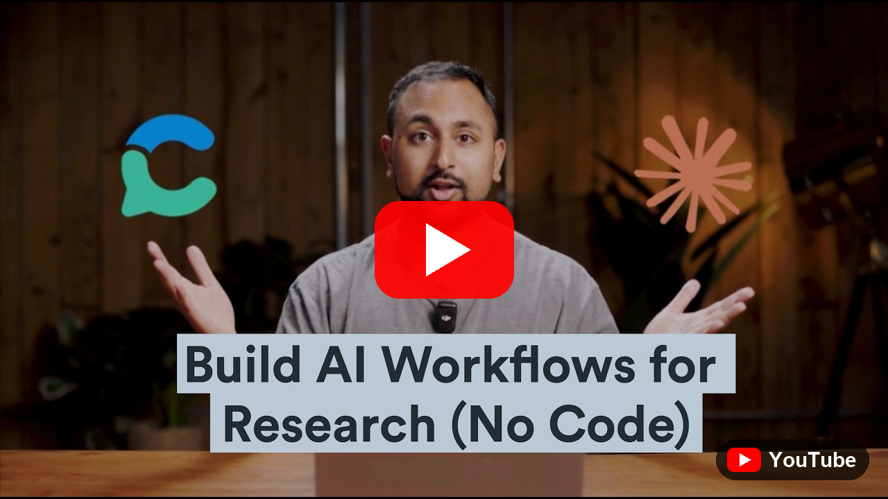

<a href="https://consensus.app"></a>

# Consensus MCP Server: Scientific Literature Search for Claude, ChatGPT and Cursor

[](https://consensus.app)
[](https://docs.consensus.app/consensus-mcp)
[](https://modelcontextprotocol.io)
[](https://x.com/ConsensusNLP)

The official Consensus MCP server gives Claude, ChatGPT, Cursor, VS Code, Microsoft 365 Copilot, Perplexity and any other MCP client semantic search over **400M+ scholarly articles, including 350M peer-reviewed papers and all of PubMed**. Your assistant can find research papers, filter them by study design and journal quality, and give answers that cite real studies, without leaving the chat.

It's a hosted remote server, so there's nothing to install. Connect, ask a research question, and get back ranked papers with DOIs, citation counts, study type, sample size and a one-line takeaway.

**Server URL**

```
https://mcp.consensus.app/mcp
```

## Why use the Consensus MCP server

- **One index for all of science.** Biomedical, clinical, psychology, computer science, economics, materials and every other field. The index includes all of PubMed and is updated weekly.
- **Semantic search, not keyword matching.** Results are ranked by how well they answer the question, so "does creatine help memory in older adults" works as written. No Boolean strings or MeSH terms needed.
- **Evidence-quality filters.** Limit results to RCTs, meta-analyses or systematic reviews (19 study types), human or controlled studies, a minimum sample size, top-quartile journals (SJR), recent years, clinical guidelines, or Medical mode (about 8M papers from the top 1,000 medical journals).
- **Full text, not just abstracts.** Licensed full text from publisher partners plus open-access full text. On paid plans, results can include the passages that answer your query.
- **A research agent when one search isn't enough.** Threads hand a question to the Consensus research agent, which searches, reads papers and writes a cited answer you can follow up on.
- **Safe for enterprise and pharma.** SOC 2 Type II. Customer data is not used to train AI models, no personal data is stored from MCP requests, and enterprise agreements can include zero data retention. See [Security and data handling](https://docs.consensus.app/enterprise/security).

## Get started

[](https://www.youtube.com/watch?v=gcMel2guYE8&t=4s)

No account is needed to try it. Sign in for more papers per search and richer results ([plans](#plans-and-limits)).

### Claude (web and desktop)

One click: open [Consensus in the Claude directory](https://claude.ai/directory/65247229-f0c7-49df-9044-fcbb8b3894c6) and click **Connect**. Or manually:

1. Open [claude.ai](https://claude.ai) (or the Claude desktop app) and go to **Settings**
2. Select **Connectors**, then **Browse connectors**
3. Search for **Consensus** and click **Connect**
4. Approve the sign-in with your Consensus account (or continue without one at reduced limits)
5. Ask a research question in any chat; Consensus appears in the tools menu

### ChatGPT

One click: open [Consensus in the ChatGPT plugin directory](https://chatgpt.com/plugins/plugin_asdk_app_6943e6f4a928819195962de16fb9ffe4) and click **Connect**. Or manually:

1. Open [chatgpt.com](https://chatgpt.com) and sign in
2. Open **Plugins** from the sidebar
3. Search for **Consensus** and click **Connect**
4. Sign in with your Consensus account when prompted
5. Ask a research question, or call it by name: "Use Consensus to find RCTs on..."

Consensus also works with **ChatGPT Deep Research**: ask it to "use Consensus" and it will run searches and cite the papers it finds. [Details](https://docs.consensus.app/mcp-clients/chatgpt).

### Claude Code

```bash
claude mcp add --transport http consensus https://mcp.consensus.app/mcp
```

### Codex

```bash
codex mcp add consensus --url https://mcp.consensus.app/mcp
codex mcp login consensus
```

Or add to `~/.codex/config.toml`:

```toml
[mcp_servers.consensus]
url = "https://mcp.consensus.app/mcp"
```

### Cursor

[](https://cursor.com/en/install-mcp?name=consensus&config=eyJ1cmwiOiJodHRwczovL21jcC5jb25zZW5zdXMuYXBwL21jcCJ9)

Or add to `~/.cursor/mcp.json`:

```json
{
  "mcpServers": {
    "consensus": {
      "command": "npx",
      "args": ["-y", "mcp-remote@latest", "https://mcp.consensus.app/mcp"]
    }
  }
}
```

### VS Code (GitHub Copilot)

Add to your MCP configuration:

```json
{
  "servers": {
    "consensus": {
      "url": "https://mcp.consensus.app/mcp"
    }
  }
}
```

### Windsurf

```json
{
  "mcpServers": {
    "consensus": {
      "serverUrl": "https://mcp.consensus.app/mcp"
    }
  }
}
```

### Microsoft 365 Copilot, Perplexity and Gemini Spark

- **Microsoft 365 Copilot**: add Consensus for Copilot from the Microsoft Marketplace, or roll it out tenant-wide ([guide](https://docs.consensus.app/enterprise/microsoft-365-copilot)). Copilot Studio is supported too ([guide](https://docs.consensus.app/mcp-clients/microsoft-365-copilot-studio)).
- **Perplexity**: add Consensus from the Perplexity connectors store ([guide](https://docs.consensus.app/mcp-clients/perplexity)).
- **Gemini Spark**: [guide](https://docs.consensus.app/mcp-clients/gemini-spark).

### Everything else

Any client that supports remote MCP servers (Streamable HTTP) works. Point it at `https://mcp.consensus.app/mcp` and sign in with OAuth, or send an API key as a Bearer token:

```
Authorization: Bearer YOUR_API_KEY
```

Running agents behind an AI gateway? There are setup guides for [LiteLLM, Portkey, Cloudflare, AWS AgentCore, Azure API Management and more](https://docs.consensus.app/enterprise/gateways/overview).

## Tools

Your assistant picks the right tool for the question.

| Tool | What it does |
|------|--------------|
| [`search`](https://docs.consensus.app/mcp-tools/search) | Find ranked, peer-reviewed papers for a query in one call. Works without an account. |
| [`create_thread`](https://docs.consensus.app/mcp-tools/create-thread) | Hand a research question to the Consensus research agent. |
| [`get_thread`](https://docs.consensus.app/mcp-tools/get-thread) | Poll a Thread and read the agent's cited answer. |
| [`add_to_thread`](https://docs.consensus.app/mcp-tools/add-to-thread) | Ask a follow-up in an existing Thread. |
| [`find_threads`](https://docs.consensus.app/mcp-tools/find-threads) | List your Threads and find an earlier one. |

`search` returns title, authors, journal, year, DOI, citation count, study type, sample size, a key takeaway and a link to the paper. Its filters cover publication date, study design (RCT, meta-analysis, systematic review, cohort study and more), human and controlled studies, minimum sample size, journal quality (SJR quartile), minimum citations, open access, preprints, clinical guidelines, Medical mode, academic field and country of study.

The Thread tools need a Consensus account or an API key. See [when to use search and when to start a Thread](https://docs.consensus.app/mcp-tools/quickstart).

## What people use it for

- **Literature reviews and systematic reviews in Claude or ChatGPT.** Find the RCTs and meta-analyses on a question, screen them, and draft a cited summary.
- **Drug discovery and target research.** Ground an internal AI scientist or copilot in peer-reviewed evidence on a target, mechanism or indication. [Owkin](https://consensus.app/home/community-voices/owkin/) plugged the Consensus MCP into its agentic AI scientist and went from curated PubMed abstracts to 25x the paper coverage in days.
- **Medical information and clinical evidence.** Answer HCP and clinician questions from top medical journals and clinical guidelines with Medical mode.
- **Citation checking.** Verify that the claims in a draft are supported by real papers.
- **Research agents in Claude Code, Codex and Cursor.** Give coding agents a literature search tool for monitoring a field or building evidence tables.

More worked examples: [docs.consensus.app/use-cases](https://docs.consensus.app/use-cases).

## Things to ask

| Ask | Try it |
|-----|--------|
| "What does the research say about creatine and cognitive function?" | [ChatGPT](https://chatgpt.com/?q=What%20does%20the%20research%20say%20about%20creatine%20and%20cognitive%20function%3F) · [Claude](https://claude.ai/new?q=What%20does%20the%20research%20say%20about%20creatine%20and%20cognitive%20function%3F) |
| "Find meta-analyses on mindfulness for anxiety published since 2020" | [ChatGPT](https://chatgpt.com/?q=Find%20meta-analyses%20on%20mindfulness%20for%20anxiety%20published%20since%202020) · [Claude](https://claude.ai/new?q=Find%20meta-analyses%20on%20mindfulness%20for%20anxiety%20published%20since%202020) |
| "Are there RCTs on intermittent fasting with more than 500 participants?" | [ChatGPT](https://chatgpt.com/?q=Are%20there%20RCTs%20on%20intermittent%20fasting%20with%20more%20than%20500%20participants%3F) · [Claude](https://claude.ai/new?q=Are%20there%20RCTs%20on%20intermittent%20fasting%20with%20more%20than%20500%20participants%3F) |
| "What is the strongest evidence for and against remote work productivity?" | [ChatGPT](https://chatgpt.com/?q=What%20is%20the%20strongest%20evidence%20for%20and%20against%20remote%20work%20productivity%3F) · [Claude](https://claude.ai/new?q=What%20is%20the%20strongest%20evidence%20for%20and%20against%20remote%20work%20productivity%3F) |

## Plans and limits

Your Consensus plan sets the limits, not your Claude or ChatGPT subscription. The MCP server and the [Consensus API](https://github.com/Consensus-NLP/consensus-api) share one monthly pool.

| | No account | Free | Pro / Teams | Deep | Enterprise |
|---|---|---|---|---|---|
| Papers per search | 3 | 10 | Up to 300 | Up to 750 | Up to 1,000 |
| Calls per month | No monthly limit | 30 | 500 | 2,000 | Custom |
| Study type, takeaway and DOI | No | No | Yes | Yes | Yes |
| Full-text excerpts | No | No | Yes | Yes | Yes |

A call is one request per 100 papers returned. Paid plans can turn on additional usage at $0.05 per call. Full details and rate limits: [MCP plans and access](https://docs.consensus.app/mcp-plans-and-access). Pricing: [consensus.app/pricing](https://consensus.app/pricing/).

## Consensus vs other research MCP servers

There are good MCP servers for PubMed, Europe PMC, OpenAlex and Semantic Scholar, most of them open-source wrappers around a free metadata API. Consensus works differently:

- **Coverage.** One server covers all of PubMed plus the rest of science (400M+ articles), so you don't need a separate server per database.
- **Ranking.** Search is semantic and tuned for research questions, rather than a pass-through to a keyword or Boolean API.
- **Evidence signals on every result.** Study type, sample size, journal quartile and a plain-language takeaway come back with each paper, so the assistant can weigh evidence instead of just listing it.
- **Full text.** Licensed and open-access full text, not abstracts only.
- **Hosted and supported.** A remote server with OAuth, API keys, SSO and SOC 2, maintained by the Consensus team. Nothing to self-host.

## For enterprises

Consensus powers research for universities, research institutions, pharma and biotech companies, and manufacturers. We work with your team to bring evidence-grounded search to internal copilots, research workflows and member-facing products: custom rate limits, SSO, zero data retention options, a DPA, and hands-on integration support.

- Read how [Owkin uses the Consensus MCP](https://consensus.app/home/community-voices/owkin/)
- See a worked example: [Building a Research Opportunity Engine](https://consensus.app/home/resources/building-a-research-opportunity-engine-copy/)
- Security review: [Security and data handling](https://docs.consensus.app/enterprise/security)

[](https://consensus.app/home/api/)

## FAQ

**Is there an MCP server for PubMed with semantic search?**
Yes. Consensus covers all of PubMed, plus the rest of the scientific literature, with semantic search and filters for study design, sample size and journal quality. Connect `https://mcp.consensus.app/mcp`.

**What's the best MCP server for scientific literature in Claude?**
Consensus is in the Claude connectors directory and works in Claude web, desktop and Claude Code. It searches 400M+ scholarly articles and returns citable papers with DOIs.

**How do I let ChatGPT search academic papers with real citations?**
Connect Consensus from the ChatGPT plugin directory. ChatGPT, including Deep Research, can then search peer-reviewed papers and cite them with links.

**Can I use it in Cursor or VS Code?**
Yes. Use the one-click Cursor install above, or add the server URL to your VS Code or Windsurf MCP config.

**Does Consensus train on my queries?**
No. Customer data is not used to train AI models, the LLM providers Consensus uses retain no request data, and no personal data is stored from MCP requests. Enterprise agreements can add zero data retention.

**Does it work for systematic reviews and meta-analyses?**
Yes. Filter by study design, run a deep literature review with Threads, and save the papers to a Consensus collection. It speeds up search and screening, but it doesn't replace a PRISMA protocol.

**Is this the same as Consensus (goconsensus.com)?**
No. This is Consensus, the AI academic search engine at consensus.app. It isn't related to the sales demo platform at goconsensus.com.

## Consensus API

Building your own application, RAG pipeline or agent? The same search is available as a REST API at `api.consensus.app/v1/search`, with a Threads API for the research agent. See the [consensus-api](https://github.com/Consensus-NLP/consensus-api) repo and the [API docs](https://docs.consensus.app/api-get-started).

## About this repo

The Consensus MCP server is a hosted remote server; there's nothing to install from source. This repo is its public home: setup guides, announcements and [issues](../../issues). Full documentation lives at [docs.consensus.app/consensus-mcp](https://docs.consensus.app/consensus-mcp).

---

Made by [Consensus](https://consensus.app), the AI search engine for research. Follow us on [X](https://x.com/ConsensusNLP) and [LinkedIn](https://www.linkedin.com/company/consensus-nlp).
